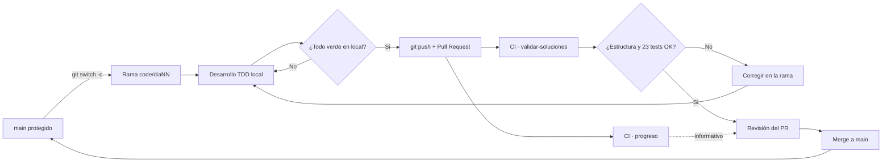

# 🔁 Flujo de integración continua (CI/CD)

Este documento describe el contrato de automatización de **Navidad en Rojo y Verde 2026**: cómo se integra un cambio, qué valida GitHub Actions y por qué el repositorio no puede fusionarse con el CI en rojo.

- Workflow: `.github/workflows/ci.yml` — **CI Navidad Roja y Verde**
- Runner: `ubuntu-latest`
- JDK: **Temurin 21** (`actions/setup-java@v4`)
- Suite: **JUnit 5.10.2** — 23 tests en 16 clases

---

## 1. El ciclo de vida del PR

### Regla invariante

> **Está prohibido hacer `push` directo a `main`.**

Todo cambio —código, enunciados o documentación— viaja por una rama y un Pull Request. `main` es la rama protegida y solo recibe merges revisados con el CI en verde.

| Elemento | Convención |
|---|---|
| Rama de trabajo | `code/diaNN` (ej. `code/dia17`, `code/dia01-08`) |
| Rama de features transversales | `feat/*` (también dispara el CI en PR) |
| Rama destino | `main` |
| Commits | Castellano, formato `feat(diaNN): ...`, `docs: ...`, `fix(diaNN): ...` |
| Merge | Merge commit del PR (el historial conserva el número de PR) |

### Recorrido completo

```bash
# 1. Partir siempre de main actualizado
git switch main
git pull --ff-only origin main

# 2. Crear la rama del reto
git switch -c code/dia17

# 3. Implementar (TDD: primero el test), enunciado y documentación

# 4. Verificación local obligatoria antes de subir
mvn clean test
mvn -Psoluciones test
bash scripts/comprobar-estructura

# 5. Commit y push de la rama
git add src enunciados README.md docs
git commit -m "feat(dia17): implementa el reto y su solucion de referencia"
git push -u origin code/dia17

# 6. Abrir el Pull Request contra main
gh pr create --base main --head code/dia17 \
  --title "feat(dia17): ..." \
  --body "## Cambios
- ...
## Verificación
- [x] mvn clean test
- [x] mvn -Psoluciones test
- [x] bash scripts/comprobar-estructura"
```

El PR queda bloqueado hasta que el job **`validar-soluciones`** termine en verde y la revisión apruebe. El merge se hace desde GitHub; nunca con `git push origin main`.

---

## 2. Disparadores y jobs

```yaml
on:
  push:
    branches: [ main ]
  pull_request:
    branches: [ main, feat/* ]
```

### Job `validar-soluciones` — bloqueante

Secuencia exacta:

1. `actions/checkout@v4` — clona el repositorio.
2. `actions/setup-java@v4` — instala Temurin 21.
3. `bash scripts/comprobar-estructura` — valida la simetría `main ↔ solutions`.
4. `mvn -Psoluciones test` — compila `src/solutions/java` y ejecuta los **23 tests**.

Si cualquiera de los pasos falla, el PR no se puede fusionar.

### Job `progreso` — informativo

1. `actions/checkout@v4` y Temurin 21.
2. `mvn test -Dmaven.test.failure.ignore=true || true` — ejecuta la suite en modo reto **sin abortar** por los rojos esperados.
3. `./scripts/progreso` — lee `target/surefire-reports` y publica el árbol navideño con el recuento de retos resueltos.

Este job **no bloquea** el merge: los fallos del modo reto son el estado natural del gimnasio. Solo informa del progreso.

---

## 3. Qué comprueba `scripts/comprobar-estructura`

El script recorre `src/main/java` y `src/solutions/java` y exige que ambos árboles sean simétricos. Diagnósticos posibles:

| Mensaje | Significado | Corrección |
|---|---|---|
| `FALTA la solucion: <ruta>` | Hay una clase en `main` sin gemela en `solutions`. | Crear el fichero de referencia con el mismo paquete y nombre. |
| `SOLUCION INCOMPLETA (...): <ruta>` | La solución de referencia aún lanza `UnsupportedOperationException`. | Implementarla. |
| `CLASE DE APOYO DISTINTA entre main y solutions: <ruta>` | La clase está implementada, pero sus bytes difieren entre los dos árboles. | Copiar el fichero literalmente para igualarlos. |
| `SOBRA en soluciones (no hay esqueleto): <ruta>` | Hay una solución huérfana. | Crear el esqueleto correspondiente o eliminar la solución. |

Salida esperada en un repositorio sano:

```text
Estructura correcta: 22 ficheros emparejados.
```

Los **22 ficheros** son 16 clases de reto más 6 clases de apoyo (`InvalidProductionException`, `ConveyorCapacityException`, `Carta`, `Posicion`, `AccesoDenegadoException` y la interfaz `Trineo`).

### Por qué la byte-identidad

Cuando un reto está resuelto, `src/main/java/reto/diaNN/Clase.java` se copia **byte a byte** (UTF-8 sin BOM, finales de línea LF, sin salto final) a `src/solutions/java/reto/diaNN/Clase.java`. Así:

- La solución de referencia es exactamente lo que valida la suite.
- Las clases de apoyo no divergen entre el enunciado y la respuesta.
- El CI detecta cualquier edición accidental o desincronización.

---

## 4. Diagrama de flujo



Equivalente en texto para terminales:

```text
main ──► rama code/diaNN ──► desarrollo TDD ──► push + PR
                                                   │
                    ┌──────────────────────────────┴──────────────────────────────┐
                    │                                                             │
            validar-soluciones (bloqueante)                              progreso (informativo)
            ├─ bash scripts/comprobar-estructura                         ├─ mvn test (fallos ignorados)
            └─ mvn -Psoluciones test  → 23/23                            └─ ./scripts/progreso
                    │
               ¿todo verde? ── no ──► corregir en la rama
                    │ sí
                 revisión ──► merge ──► main
```

---

## 5. Checklist local antes de abrir el PR

Ejecuta los tres comandos y adjunta la salida real en la descripción del PR:

```bash
mvn clean test
mvn -Psoluciones test
bash scripts/comprobar-estructura
```

Resultados de referencia:

```text
[INFO] Tests run: 23, Failures: 0, Errors: 0, Skipped: 0
[INFO] BUILD SUCCESS
Estructura correcta: 22 ficheros emparejados.
```

Además:

- `git status --short` debe mostrar solo los ficheros intencionados.
- Los ficheros nuevos deben ser **UTF-8 sin BOM** y usar **LF** (lo impone `.gitattributes`).
- `scripts/progreso` debe conservar el bit de ejecución (`git update-index --chmod=+x scripts/progreso` si se pierde).

---

## 6. Diagnóstico rápido de fallos

| Fallo en CI | Causa habitual | Acción |
|---|---|---|
| `SOLUCION INCOMPLETA` | La referencia sigue con `UnsupportedOperationException`. | Implementar la solución. |
| `CLASE DE APOYO DISTINTA` | Se editó una copia y no la otra. | Copiar el fichero idéntico a ambos árboles. |
| `FALTA la solucion` / `SOBRA en soluciones` | Árboles descompensados. | Emparejar paquete, nombre y ruta. |
| `mvn -Psoluciones test` falla | Error de compilación o expectativa de test incumplida. | Ejecutar el test concreto en local y corregir la referencia. |
| Job `progreso` en rojo | Problema del propio script o permisos. | Revisar `scripts/progreso` y su bit de ejecución. |

---

## 7. Criterios de merge

Un Pull Request se fusiona cuando:

1. **`validar-soluciones`** está en verde.
2. La revisión aprueba el cambio.
3. La rama está actualizada con `main` sin conflictos.
4. El commit sigue la convención (`feat(diaNN): ...`).
5. La documentación afectada (README, enunciado, este documento) está actualizada.

El job `progreso` puede estar en rojo: es el termómetro del gimnasio, no una puerta de calidad.
