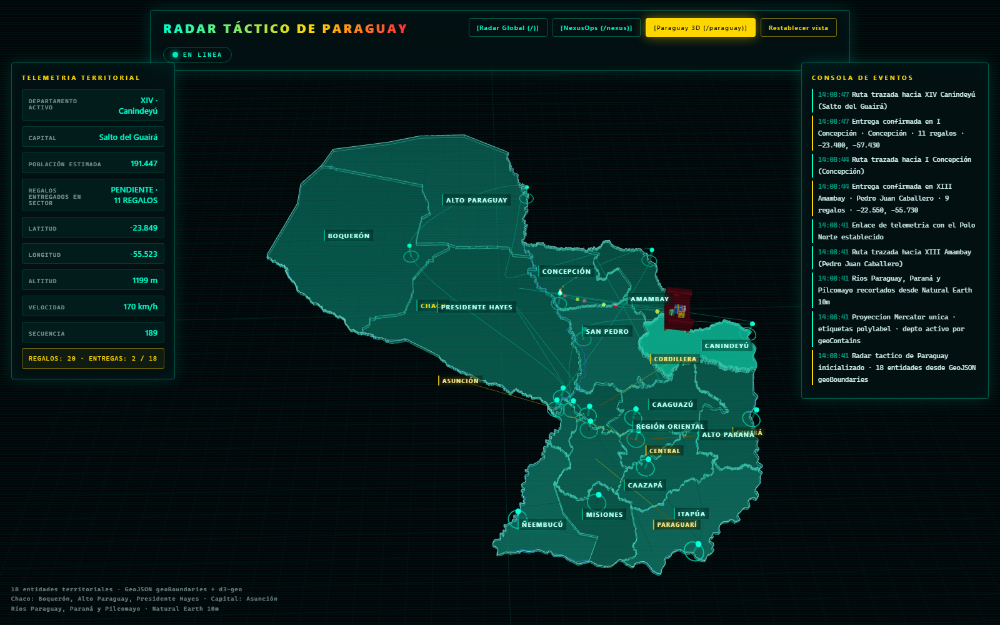

# Mapa real de Paraguay en `/paraguay`

La vista `/paraguay` dibuja los 17 departamentos y Asunción con geometrías reales,
proyectadas una sola vez con Mercator, sobre las que se apoya la ruta 3D del trineo.
Todo el material cartográfico y las librerías viajan con el repositorio: la página no
hace peticiones a CDNs ni a servicios externos.



## Fuentes y licencias

| Recurso | Origen | Licencia |
| --- | --- | --- |
| `paraguay-departamentos.geojson` | [geoBoundaries](https://www.geoboundaries.org/) `PRY ADM1`, edición descargada en 2026 | CC BY 4.0 |
| `paraguay-contorno.geojson` | Disolución de la capa ADM1 anterior con mapshaper | CC BY 4.0 (obra derivada) |
| `paraguay-rios.geojson` | [Natural Earth](https://www.naturalearthdata.com/) `ne_10m_rivers_lake_centerlines` | Dominio público |
| `vendor/three.module.js` + addons | Three.js 0.160.0 | MIT |
| `vendor/d3-geo.esm.js` | d3-geo 3.1.1 empaquetado con esbuild | ISC |
| `vendor/polylabel.esm.js` | polylabel 2.0.1 empaquetado con esbuild | ISC |

Atribución recomendada al reutilizar los datos:

> Límites administrativos: geoBoundaries (CC BY 4.0). Ríos: Natural Earth (dominio público).

## Cómo se generó

1. **Descarga**: `geoBoundaries-PRY-ADM1.geojson`, 18 features (los 17 departamentos
   más `ASUNCION`; todas las geometrías son `Polygon`, aunque el código admite
   `MultiPolygon`).
2. **Simplificación**: mapshaper 0.7.97 con
   `-simplify 5% keep-shapes -clean -o format=geojson precision=0.0001`.
   Se probaron 3 %, 4 % y 5 %; el 5 % conserva mejor la silueta y deja el fichero en
   249.159 bytes, por debajo del límite de 300 KB que vigila la suite.
3. **Normalización**: cada feature expone exactamente
   `{ id, nombre, romano, capital, capitalLat, capitalLon, poblacion }`.
   `id` es el `shapeISO` original (por ejemplo `PY-19`), Asunción usa
   `romano = "CAPITAL"` y las poblaciones se heredaron del panel anterior.
4. **Winding para d3-geo**: d3 interpreta los anillos en la esfera y espera el
   **exterior en sentido horario** (área planar negativa) y los agujeros en sentido
   antihorario, al contrario que la convención planar de RFC 7946. Los anillos se
   reorientaron y se verificó con el propio bundle: `geoArea` pequeño por feature,
   `geoContains(capital) === true` en las 18 y
   `geoBounds` = `[[-62.6446, -27.5918], [-54.2589, -19.2896]]`.
5. **Contorno**: disolución de los 18 polígonos con `mapshaper -dissolve`; la salida
   era un `GeometryCollection`, se envolvió en `FeatureCollection`/`Feature` para que
   el navegador la trate como una capa más.
6. **Ríos**: Natural Earth 10m no separa el curso principal del río Paraguay en una
   feature propia; su trazado viaja dentro del sistema etiquetado como `Paraná`. Las
   líneas se clasificaron por corredor geográfico (oeste de `lon = -57.2` entre
   `lat = -26` y `-21` para el Paraguay) y se recortaron punto a punto contra el
   contorno nacional, porque `mapshaper -clip` no las recortaba en esta combinación.
   Resultado: 78 segmentos (Paraguay 34, Paraná 24, Pilcomayo 20), todos dentro del
   país.

## Proyección y 3D

- Una única fuente de verdad: `geoMercator().fitSize([120, 150], geojson)`.
  `proyectar(lon, lat)` devuelve `{x, z}` centrado en el mapa e `invertir(x, z)`
  recupera `{lon, lat}`. El HUD, los nodos, la silueta y la telemetría usan esas dos
  funciones; no hay coordenadas de pantalla duplicadas.
- Al arrancar se comprueba el viaje de ida y vuelta de las 18 capitales y se aborta
  si el error supera `0.001°`.
- Los polígonos se convierten en `THREE.Shape` con agujeros y se extruyen
  (`ExtrudeGeometry`); los bordes se dibujan con `EdgesGeometry`. Las etiquetas usan
  `polylabel` sobre el polígono mayor, con los anillos reorientados a antihorario
  antes de llamar a la librería.
- La ruta del trineo recorre Asunción, después la Región Oriental por latitud
  descendente y por último el Chaco. Cada fotograma se corrige con `geoContains`
  para que el vehículo no salga del territorio, y el sector activo se decide con la
  misma prueba espacial (limitada a 0,12 s).

## Verificación

- `MapaParaguayTest` comprueba las 18 entidades y sus propiedades, la caja
  envolvente, que cada capital cae dentro de su polígono, el orden espacial, el área
  total (±3 % de 406.752 km²), el tamaño del GeoJSON, el uso de recursos locales y
  que el HTML mantiene una sola proyección y la identidad del radar.
- `QuantumDashboardServerTest` sirve `/paraguay`, `/data/*` y `/vendor/*` con sus
  tipos MIME y rechaza rutas con `..`.
- La captura de `docs/paraguay-radar.png` se tomó con Playwright (1600×1000) tras
  cargar la página: sin errores de consola, con las 20 etiquetas (18 entidades +
  CHACO + REGIÓN ORIENTAL) y el HUD actualizándose.

## Regenerar los datos

```bash
npx mapshaper geoBoundaries-PRY-ADM1.geojson \
  -simplify 5% keep-shapes -clean \
  -o format=geojson precision=0.0001 paraguay-simplificado.geojson
```

Después hay que volver a normalizar propiedades, redondear a 4 decimales y reorientar
los anillos con la convención de d3 descrita arriba. Los ficheros finales viven en
`src/main/resources/static/data/`.
